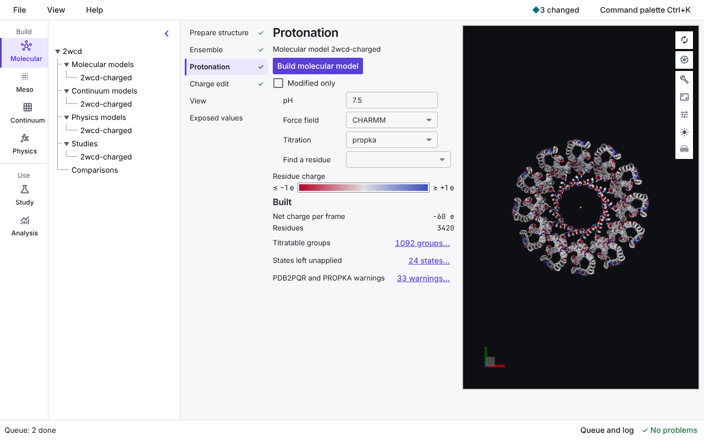
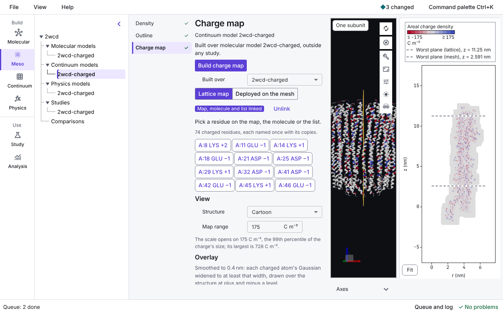
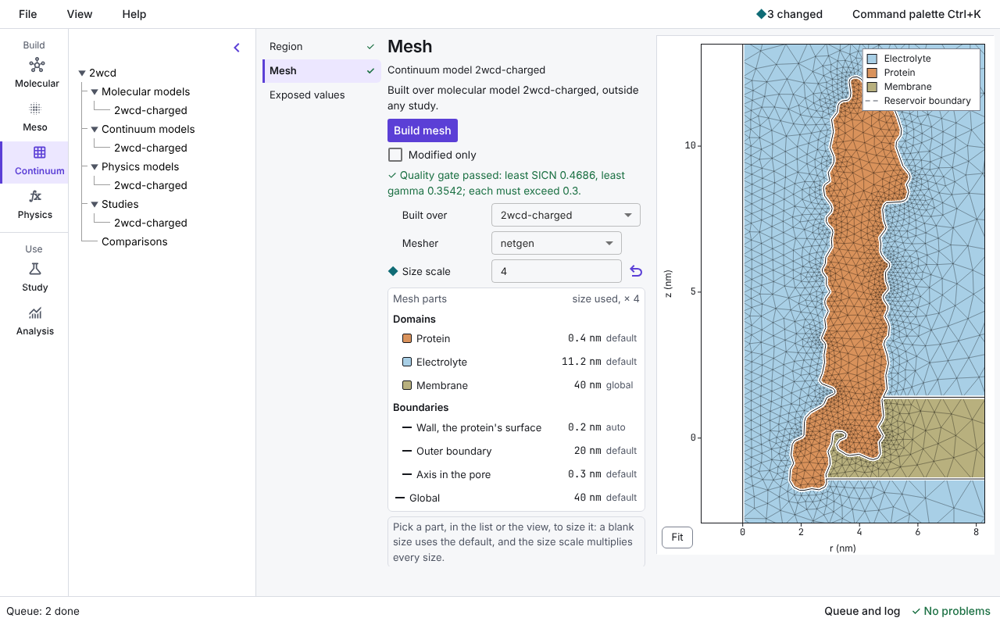
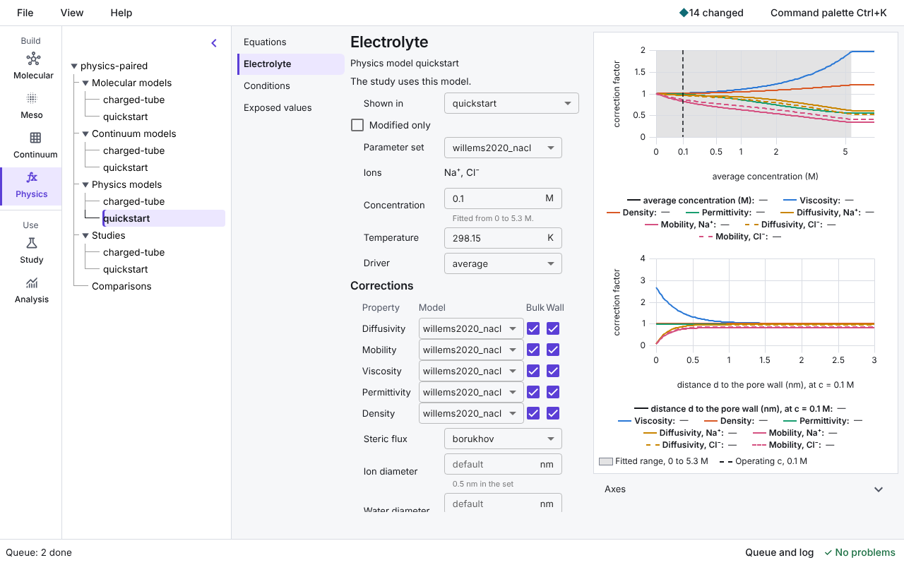
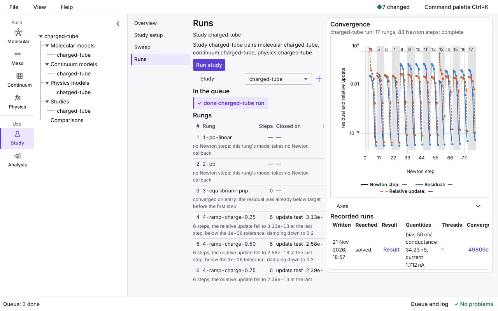
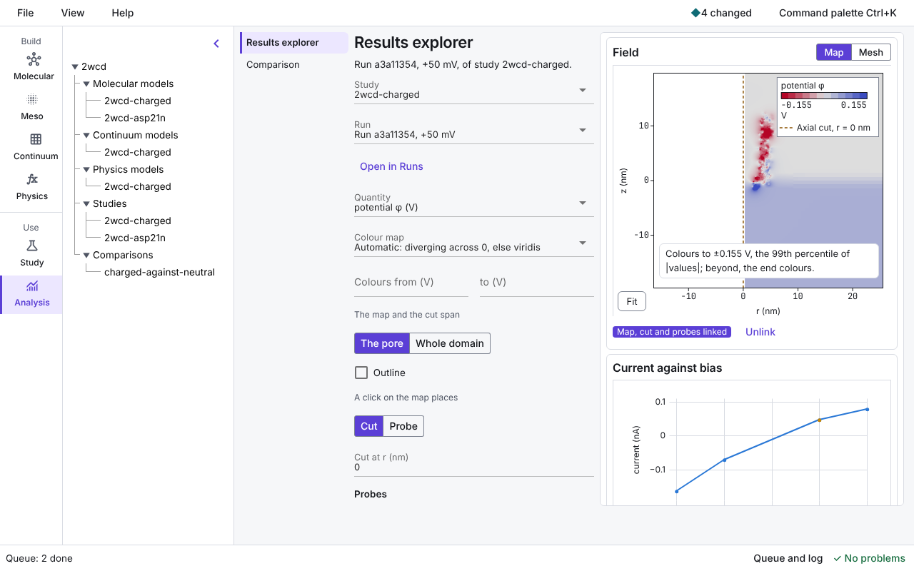

# The workbench

The workbench is a local server that you open in the browser. It is the one graphical interface of
nanopnp. It is a thin shell over the library: the library holds every number and every check, and the
workbench shows them.

## Install

Run `uv sync --all-extras`, or install the `gui` extra alone. Then run the self-test:

```console
$ nanopnp gui --selftest
```

The self-test exercises each compiled part once. NGSolve and Netgen mesh a square. A server child
serves the shipped field renderer. MDAnalysis and gemmi read a structure. scikit-image and Shapely
run. Gmsh runs where it is installed. PDB2PQR with PROPKA protonates a fragment. The test prints one
line for each part, or names the part that failed.

An installation that runs a case is used under GPL-2+, because the default solver, UMFPACK, is GPL-2+.
`nanopnp --env` states this and names `THIRD-PARTY-LICENSES.md`.

## Start

```console
$ nanopnp gui [<project folder>]
```

The command starts the server and opens the browser. With no folder, it opens the last project. A
missing or empty folder becomes a new project. Add `--no-browser` to print the address and open
nothing.

To work on an existing case file, turn it into a project:

```console
$ nanopnp project import case.yaml <project folder>
```

## The window

Six suites stand in the bar on the left. Molecular, Meso, Continuum and Physics build the models.
Study and Analysis use them. Each suite has a list of tools. The selected tool shows its settings
beside its live view.

| Suite | Tools |
|---|---|
| Molecular | Prepare structure, Ensemble, Protonation, Charge edit, View, Exposed values |
| Meso | Density, Outline, Charge map |
| Continuum | Region, Mesh, Exposed values |
| Physics | Equations, Electrolyte, Conditions, Exposed values |
| Study | Overview, Study setup, Sweep, Runs |
| Analysis | Results explorer, Comparison |

The project tree stands beside the tool list. The status line at the bottom shows the run queue and the
problem count. *Queue and log* opens the bottom panel. Its Problems tab lists each refusal, with the
rule and the case path. *Settings* is in the File menu. The command palette opens with Ctrl+K.

## Molecular

Molecular prepares the structure and its charge. Open a structure and set its axis in Prepare
structure. Set the pH, the force field and the titration in Protonation, then build the molecular
model. The picture shows Protonation on 2WCD: the net charge per frame, the number of titratable
groups, and the molecule coloured by residue charge.



## Meso

Meso draws a continuum model from the molecular model beside the molecule. Density and Outline give the
pore's density map and outline, and you can edit the outline. Charge map builds the charge over the
molecular model. The picture shows the Charge map: the cut molecule, the areal charge density in (r, z)
with a colour bar, and the charged residues in a list.



## Continuum

Continuum sets the region and the mesh. Region sets the membrane and the reservoir. In Mesh, choose the
mesher and the size scale, then build the mesh. The quality gate reports its verdict first. The picture
shows the Mesh tool: the mesh in (r, z) coloured by material, and the list of mesh parts with their sizes.



## Physics

Physics sets the equations, the electrolyte and the conditions of a physics model. Electrolyte holds the
parameter set, the concentration, the temperature and a table of corrections. The picture shows two plots:
each correction factor against the concentration and against the distance to the pore wall.



## Study

A study pairs one molecular, one continuum and one physics model. Set its overrides in Study setup, add
a sweep, and run it in Runs. The picture shows the convergence of a finished run in Runs: the residual
and the relative update at each Newton step, in one band for each continuation rung, with the rung table
and the recorded runs.



## Analysis

Analysis reads the results of runs. The results explorer shows a field of a run as a map or on the mesh,
with a quantity, a colour map and an axial cut. A graph shows current against bias. Comparison puts two
runs side by side. The picture shows the results explorer on the potential of a run.



## Known gaps

The workbench meets the keyboard requirement (QR-16) in part:

- An outline's vertex is picked only by a click.
- Continuum's handles have no keyboard path.
- A shortcut chord cannot be unbound.

A vertex is moved by typing its r and z. It is not dragged.

Five display details are carried to the next phase (REV-274). Each number is in the run's record and on
the command line.

- A stage's record in part: the alignment, the density's grid, the region's assembly and the mesh's wall sizes.
- The place that *Measure* marks for a failed outline criterion.
- The dielectric on the mesh in the deployed field.
- The conservation view's solid share, charge per material and boundary ring.
- Protonation's frames after the first.
